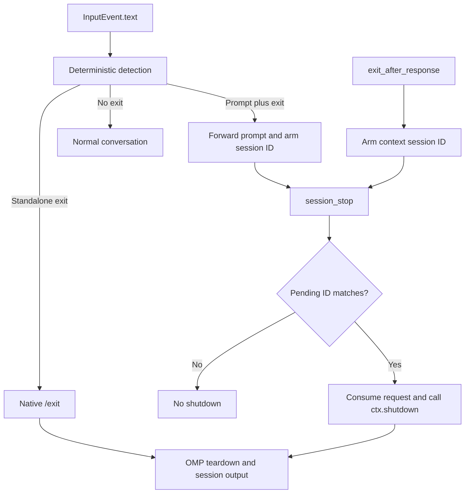

# Architecture and runtime contracts

## Scope and language decision

The plugin recognizes OMP exit intent; OMP owns persistence, terminal cleanup, process termination, and session output. It must not infer instructions about exiting other programs as standalone exit commands.

Keep JavaScript ESM. The package has two small runtime entry points, no runtime dependencies, no build step, and native `node:test` coverage. TypeScript would add checking/toolchain maintenance without removing the observed regex or lifecycle risks. A compiled-language implementation would still need a JavaScript adapter to receive OMP extension callbacks. Revisit the choice only when a concrete integration or correctness requirement changes those tradeoffs.

## Runtime boundary

The integration has been exercised on OMP 18.12.2; that is a verified baseline, not a claim about the earliest compatible release. Use OMP's public extension API rather than guessing older callback shapes:

- Input arrives as an `InputEvent`; read and trim `event.text`.
- The active session ID is `ctx.sessionManager.getSessionId()`. Read it at each event: OMP can reuse a session-manager object while changing its active session.
- Tool execution receives `(toolCallId, params, signal, onUpdate, ctx)`. The fifth argument is the context; do not search arbitrary arguments for one.
- Deferred exits require the `session_stop` event and `ctx.shutdown()`.

`index.js` owns deterministic classification and its pending session IDs. `ai-exit.js` owns the optional tool and its pending session IDs. The manifest loads the base extension unconditionally and the AI entry point through `ai-exit-detection`. Neither module owns process-wide mutable state or output formatting.

## Shutdown ownership

Immediate exits abort the active turn before returning `{ text: "/exit" }`. Returning `{ handled: true }` after calling `ctx.shutdown()` is not equivalent: the input controller can return before the REPL reaches the idle boundary that drains the shutdown flag.

A pending exit is scoped to a session ID and consumed once. There is no context-free "next session stop" fallback: an unrelated session must not inherit an exit request. Native shutdown is responsible for asynchronous `session_shutdown` hooks and for deciding whether a persisted session has a resume hint. Do not print a duplicate hint, manufacture an ID, or add a timer calling `process.exit()`.

## Parsing invariants

The deterministic vocabulary and public examples belong in the [README](/README.md#behavior). Classification checks standalone commands first. For prompt-and-exit, explicit directives precede conversational farewells; within each group the existing order is comma/semicolon, sentence punctuation, `then`/`and then`, then `and`.

That precedence preserves prompt content. For example, `do X and thanks! bye for now.` forwards `do X and thanks`, rather than silently discarding the courtesy text before the sentence delimiter.

Prompt captures before variable separator whitespace must end at a non-whitespace character. Otherwise lazy captures and overlapping whitespace repetitions can repeatedly repartition the same pasted text. Trim trailing prompt separators with a backward scan rather than an unanchored repeated-character regex. Preserve internal prompt whitespace, and verify changes against both positive and negative input examples; do not replace the ordered grammar with an apparently simpler suffix parser without checking its precedence.
