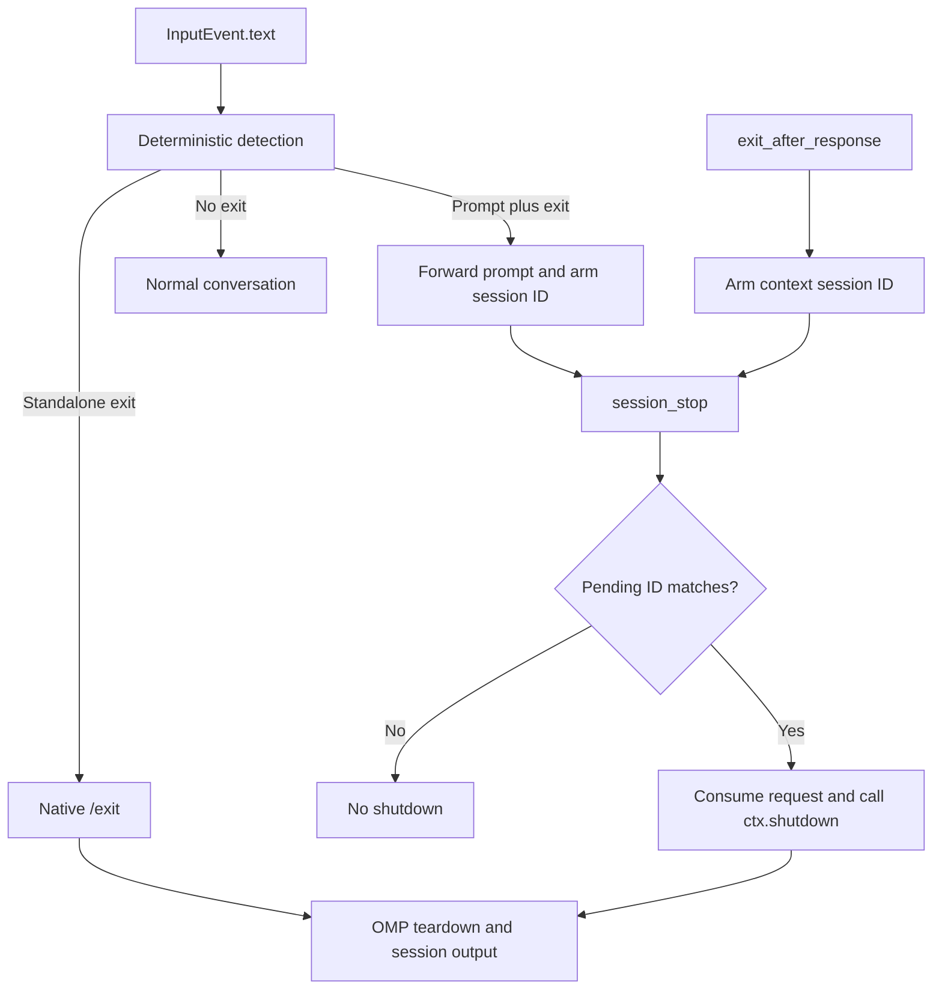

# Architecture and runtime contracts

## Scope and language decision

The plugin recognizes OMP exit intent; OMP owns persistence, terminal cleanup, process termination, and session output. It must not infer instructions about exiting other programs as standalone exit commands.

Keep JavaScript ESM. The package has two small runtime entry points, no runtime dependencies, no build step, and native `node:test` coverage. TypeScript would add checking/toolchain maintenance without removing the observed regex or lifecycle risks. A compiled-language implementation would still need a JavaScript adapter to receive OMP extension callbacks. Revisit the choice only when a concrete integration or correctness requirement changes those tradeoffs.

## Runtime boundary

The integration has been exercised on OMP 18.12.2; that is a verified baseline, not a claim about the earliest compatible release. Use OMP's public extension API rather than guessing older callback shapes:

- Input arrives as an `InputEvent`; read and trim `event.text`.
- The active session ID is `ctx.sessionManager.getSessionId()`. Read it at each event: OMP can reuse a session-manager object while changing its active session.
- Tool execution receives `(toolCallId, params, signal, onUpdate, ctx)`. The fifth argument is the context; do not search arbitrary arguments for one.
- Deferred exits require the `session_stop` event and `ctx.shutdown()`.

`index.js` owns deterministic classification, its pending session IDs, and the bounded `ompi` resume-hint adapter described below. `ai-exit.js` owns the optional tool and its pending session IDs. The manifest loads the base extension unconditionally and the AI entry point through `ai-exit-detection`.

## Shutdown ownership

Immediate exits abort the active turn before returning `{ text: "/exit" }`. Returning `{ handled: true }` after calling `ctx.shutdown()` is not equivalent: the input controller can return before the REPL reaches the idle boundary that drains the shutdown flag.

A pending exit is scoped to a session ID and consumed once. There is no context-free "next session stop" fallback: an unrelated session must not inherit an exit request. Native shutdown is responsible for asynchronous `session_shutdown` hooks and for deciding whether a persisted session has a resume hint. Do not print a duplicate hint, manufacture an ID, or add a timer calling `process.exit()`.

Before handing an immediate exit to native `/exit`, or calling `ctx.shutdown()` for a deferred or AI-assisted exit, the plugin synchronously emits `omp-exit-command:exit-requested` on `pi.events` with `{ sessionId }` from the active context. A cooperating supervisor matches that ID to its main session and suppresses relaunch, even if a restart was already queued. The event announces explicit exit intent, not completed teardown; OMP still owns settlement and termination. Ordinary prompts and stop events without a matching pending exit do not emit it.

`ompi` must implement this event contract to give explicit exit precedence. Without that consumer, the plugin still performs native shutdown, but an older wrapper may satisfy an accepted restart by reopening the session.

### Wrapped resume hints

OMP 18.12.6 hard-codes the native resume command and exposes no public override. At main-TUI `session_shutdown`, the base extension verifies `OMP_INSTANCE_CONTROL_LAUNCH_DIR` and `OMP_INSTANCE_CONTROL_LAUNCH_TOKEN` against the wrapper's version-1 `launch.json`, including its direct-parent PID. Inherited variables in nested OMP processes, peer-control-only installations, missing records, and mismatched tokens do not qualify.

For a verified launch, a temporary `process.stderr.write` adapter recognizes only the complete final native hint for the active session ID and substitutes `ompi` for `omp`. It retains native profile arguments, resume flags, colors, and stream behavior, then restores the previous writer before forwarding that hint. All other output passes through unchanged. OMP still decides whether a persisted session has a hint and still owns teardown and termination; no second hint is printed.

This is an explicit native-output compatibility boundary, verified on OMP 18.12.6 with `ompi` 0.10.1. An unrecognized future hint remains unchanged. Remove the adapter when OMP exposes a supported launcher/resume-command override; do not expand it into general output interception.

## Parsing invariants

The deterministic vocabulary and public examples belong in the [README](/README.md#behavior). Classification checks standalone commands first. Prompt-and-exit classification only arms the active session ID; the input hook returns no replacement, so OMP forwards the original input with its exit directive and all whitespace intact.

Prompt patterns span line breaks, including paragraph breaks and indented text. Use dot-all matching, not multiline anchors: the exit directive must still end the entire input, not an arbitrary line within it.

Prompt matches before variable separator whitespace must end at a non-whitespace character. Otherwise lazy matches and overlapping whitespace repetitions can repeatedly repartition large pasted text. Keep positive and negative grammar coverage and the bounded large-input smoke when changing these patterns.
